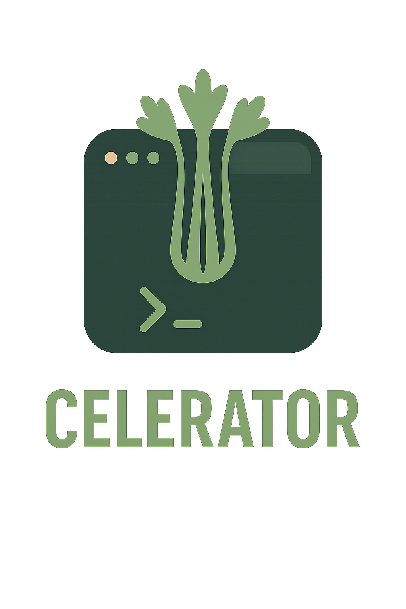

  

<h1 align="center">CeleryWatch</h1>

---

## What is CeleryWatch?

**CeleryWatch** is a TUI (Text User Interface) application for debugging and monitoring Celery tasks in real time. It connects to your Celery broker (Redis, RabbitMQ, etc.), listens to task lifecycle events, and presents them in an interactive terminal interface — complete with retry capabilities, traceback viewing, and more.

It uses Celery's built-in **event system**, meaning no code changes are required in your app — just run your workers with `--events` enabled.

The interface is built using [Textual](https://github.com/Textualize/textual), a modern TUI framework for Python.

---

